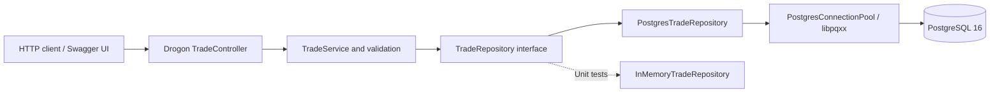

# TradeVault — C++20 Trade-Capture Microservice

[](https://github.com/alankhal/tradevault/actions/workflows/ci.yml)


TradeVault is a C++20 REST API for creating, retrieving, listing, and cancelling financial trades. It validates trade data, uses PostgreSQL for persistent storage, and runs in a Docker Compose environment. Automated GitHub Actions workflows build and test the service on Windows and Linux, verify the running containers, publish a Docker image, and scan that image for critical vulnerabilities.

**Current progress:** Milestones M0–M4 are implemented. The service is containerized, backed by PostgreSQL, covered by automated tests, and published through GitHub Container Registry (GHCR). Additional trading-system features, observability, and deployment automation remain future work.

---

## Purpose

I built TradeVault to learn how financial institutions design and operate the services used to capture trades. The project focuses on C++ backend engineering, well-defined API boundaries, database consistency, automated testing, and container-based delivery.

Trade capture involves more than accepting an HTTP request. A useful service must validate incoming data, persist it reliably, return understandable errors, and expose a stable interface to its clients. TradeVault explores these concerns incrementally rather than attempting to reproduce a production bank system.

| Engineering concern | Current approach |
|---|---|
| Domain rules | C++20 model, validation, and `TradeService` |
| HTTP interface | Drogon REST controllers and JSON responses |
| API documentation | OpenAPI 3 specification and Swagger UI |
| Persistent storage | PostgreSQL 16 and libpqxx |
| Storage abstraction | `TradeRepository` interface with PostgreSQL and in-memory implementations |
| Database consistency | PostgreSQL constraints, parameterized queries, and transactions |
| Reproducible environments | Multi-stage Dockerfile and Docker Compose |
| Automated quality checks | GoogleTest, clang-tidy, API smoke tests, and GitHub Actions |
| Image distribution and scanning | GHCR and Trivy |

This is a learning project informed by general financial-software engineering practices. It does not use or reproduce proprietary bank infrastructure.

---

## Key design decisions

- **C++20 throughout the backend.** The service uses C++ for domain logic, persistence integration, and the HTTP application.
- **Separation of responsibilities.** Controllers handle HTTP and JSON; `TradeService` handles domain operations; repositories handle storage.
- **Dependency injection.** `TradeService` depends on a `TradeRepository` abstraction, allowing in-memory tests without a database.
- **Explicit domain errors.** Service operations use `Result<T, E>` to represent expected successes and failures. HTTP error mapping translates domain errors into status codes and JSON responses.
- **Database-generated trade IDs.** PostgreSQL assigns an integer ID when a trade is inserted. Clients do not supply the trade ID.
- **Transactional database writes.** Trade inserts and updates use database transactions, and SQL values are passed as parameters rather than interpolated into query strings.
- **Container health checks.** Docker Compose waits for PostgreSQL readiness and monitors the API's `/healthz` endpoint.
- **Non-root runtime container.** The production image uses a multi-stage build and starts the application under an unprivileged account.

**Current limitation:** Requests do not yet include an idempotency key or a client-supplied unique booking reference. Submitting the same `POST /trades` body again can create another trade. Deduplication and retry-safe booking are planned improvements.

---

## Quickstart

### Prerequisites

- Docker Desktop or Docker Engine with the Docker Compose plugin
- Git

You do **not** need to install the C++ toolchain or PostgreSQL separately to run the Compose stack.

### 1. Clone and configure

In PowerShell:

```powershell
git clone https://github.com/alankhal/tradevault.git
cd tradevault
Copy-Item .env.example .env
notepad .env
```

Replace `YOUR_DOCKER_PASSWORD` in `.env` with a password for your local PostgreSQL container. On macOS or Linux, use `cp .env.example .env` instead of `Copy-Item`.

Do not commit `.env` or put real passwords in the repository.

### 2. Build and start the application

```powershell
docker compose up -d --build --wait
docker compose ps
```

Both `api` and `db` should report **healthy**. The first build may take longer while Docker downloads and compiles C++ dependencies.

### 3. Open the application

| Resource | Local URL |
|---|---|
| API health endpoint | http://127.0.0.1:8080/healthz |
| Swagger UI | http://127.0.0.1:8080/swagger.html |
| OpenAPI specification | http://127.0.0.1:8080/openapi.json |

The API is bound to `127.0.0.1:8080` by the provided Compose configuration.

### 4. Create and retrieve a trade

These examples use PowerShell's `Invoke-RestMethod`.

**Create a trade:**

```powershell
$body = @{
    instrument = "AAPL"
    counterparty = "Goldman Sachs"
    side = "Buy"
    price = 215.50
    quantity = 10
} | ConvertTo-Json

$created = Invoke-RestMethod -Uri "http://127.0.0.1:8080/trades" -Method Post -ContentType "application/json" -Body $body
$created
```

A successful request returns **201 Created** and a JSON trade containing a PostgreSQL-generated numeric `id` and an initial `Booked` status.

**Retrieve the new trade:**

```powershell
Invoke-RestMethod "http://127.0.0.1:8080/trades/$($created.id)"
```

**List all stored trades:**

```powershell
Invoke-RestMethod "http://127.0.0.1:8080/trades"
```

**Cancel the new trade:**

```powershell
Invoke-RestMethod -Uri "http://127.0.0.1:8080/trades/$($created.id)/cancel" -Method Post
```

### 5. Stop the services

```powershell
docker compose down
```

This stops and removes the containers while retaining the named PostgreSQL volume. Trade data remains available when you start the stack again.

**Data-loss warning:** `docker compose down -v` also deletes the named database volume. Do not run it unless you intentionally want to discard the stored data.

---

## API reference

The API contract is maintained in [`public/openapi.json`](public/openapi.json), with interactive documentation available through Swagger UI at `/swagger.html`.

| Method | Route | Behavior | Typical success status |
|---|---|---|---|
| `GET` | `/healthz` | Returns an HTTP service health response | `200` |
| `POST` | `/trades` | Validates and stores a new trade | `201` |
| `GET` | `/trades` | Returns all stored trades as a JSON array | `200` |
| `GET` | `/trades/{id}` | Retrieves a trade using its numeric ID | `200` |
| `POST` | `/trades/{id}/cancel` | Cancels an existing trade | `200` |

### Request fields

`POST /trades` accepts the following JSON fields:

| Field | Type | Example |
|---|---|---|
| `instrument` | String | `"AAPL"` |
| `counterparty` | String | `"Goldman Sachs"` |
| `side` | String | `"Buy"` or `"Sell"` |
| `price` | Number, greater than zero | `215.50` |
| `quantity` | Integer, greater than zero | `10` |

The application generates the trade's ID and timestamp. The list endpoint currently returns all trades; pagination is not implemented.

### Error handling

Expected domain errors are translated into HTTP status codes:

| Condition | Status |
|---|---|
| Invalid trade fields or malformed JSON | `400 Bad Request` |
| Unknown trade ID | `404 Not Found` |
| Conflicting operation, such as cancelling an already cancelled trade | `409 Conflict` |
| Internal error represented by the domain error mapper | `500 Internal Server Error` |

Error responses use a JSON structure with fields such as `type`, `title`, `status`, and `detail`. The project follows a *problem-details-style* shape; it does not currently guarantee every aspect of RFC 7807, including the `application/problem+json` media type.

Example:

```json
{
  "type": "about:blank",
  "title": "Bad Request",
  "status": 400,
  "detail": "Side must be either Buy or Sell"
}
```

The `/healthz` handler currently returns `{"status":"ok"}` when the HTTP service responds. It does not run a database query on every health request; database connection setup happens separately during application startup.

---

## Architecture



**Domain layer:** `Trade`, validation, and `TradeService` hold the business operations. `Result<T, E>` makes expected errors explicit.

**HTTP layer:** Drogon routes requests to `TradeController`. `TradeJson` handles trade serialization, and `HttpErrorMapper` maps domain errors into JSON error responses.

**Persistence layer:** `PostgresTradeRepository` implements the repository abstraction, uses libpqxx with parameterized SQL, and borrows connections from `PostgresConnectionPool`.

### PostgreSQL storage

- Schema initialization is defined in [`migrations/0001_create_trades.sql`](migrations/0001_create_trades.sql).
- `trade_id` is a PostgreSQL-generated identity column and primary key.
- Database constraints reject invalid values such as nonpositive prices or quantities and unsupported side or status values.
- Write operations use transactions so a failed transaction is not partially committed.
- Docker's PostgreSQL initialization mechanism applies the mounted SQL file when a **new, empty database volume** is initialized. It does not automatically rerun migrations against an existing volume on every startup.

### Containers

[`Dockerfile`](Dockerfile) uses a build stage with the compiler and vcpkg, followed by a smaller runtime stage containing the application executable, configuration, and Swagger files. The application runs as the `tradevault` user.

[`compose.yaml`](compose.yaml) starts two services:

- `db`: PostgreSQL 16 with a persistent named volume and a readiness check using `pg_isready`.
- `api`: TradeVault with a `/healthz` check, a database connection string, and a dependency on the database being healthy.

Compose publishes only the API port to the host. PostgreSQL is available on the Compose network rather than exposed as a host port by default.

---

## Development and testing

### Toolchain

Native development uses a C++20 compiler, CMake, Ninja, vcpkg, Drogon, libpqxx, and GoogleTest. The project supplies CMake presets for debug and release builds.

With `VCPKG_ROOT` set up for your environment:

```powershell
cmake --preset debug
cmake --build --preset debug
```

### GoogleTest

The current suite registers **52 GoogleTests**: 33 core/domain tests, 7 PostgreSQL tests, and 12 controller tests.

To run the tests that do not require PostgreSQL:

```powershell
ctest --preset debug -E '^Postgres'
```

To run the full suite, including database tests, a PostgreSQL instance and a valid `TRADEVAULT_DB_CONNECTION` environment variable are required. The Linux GitHub Actions job provisions its own test database and runs all 52 tests; the Windows CI job runs the 45 tests that do not need PostgreSQL.

### Docker Compose API smoke test

After starting the Compose stack, run:

```powershell
powershell -NoProfile -ExecutionPolicy Bypass -File .\tests\compose_api_smoke.ps1
```

The smoke script checks `/healthz`, creates a trade with `POST /trades`, and retrieves it with `GET /trades/{id}`. It writes a test trade to the connected database.

### Repository layout

| Path | Purpose |
|---|---|
| `app/main.cpp` | Drogon application initialization and dependency wiring |
| `src/core/` | Domain model, service, and in-memory repository |
| `src/api/` | HTTP controller, JSON serialization, and error mapping |
| `src/db/` | PostgreSQL repository and connection pool |
| `src/include/` | Shared public headers |
| `migrations/` | PostgreSQL initialization SQL |
| `public/openapi.json` | OpenAPI specification |
| `public/swagger.html` | Swagger UI entry point |
| `config/` | Drogon configuration, including Docker-specific settings |
| `tests/` | GoogleTest files and Compose smoke script |
| `Dockerfile` | Multi-stage application container build |
| `compose.yaml` | API and PostgreSQL orchestration |
| `.github/workflows/ci.yml` | Automated build, test, publish, and scan pipeline |

---

## Continuous integration and delivery

GitHub Actions runs automatically for pull requests and pushes to `main`.

### Build and verification

The workflow performs these checks:

| Job | What it verifies |
|---|---|
| Windows build and tests | MSVC compilation and 45 database-independent GoogleTests |
| Linux build and tests | Linux compilation and all 52 GoogleTests using temporary PostgreSQL |
| Static analysis | `clang-tidy` against the configured C++ project |
| Docker Compose integration | Builds and starts both containers, then executes API smoke tests |

### Image publication

For pushes to `main`, the `publish-image` job runs **after** the four build, testing, and static-analysis checks have passed. It publishes the Docker image to GHCR with two tags:

```text
ghcr.io/alankhal/tradevault:latest
ghcr.io/alankhal/tradevault:sha-<commit-sha>
```

To retrieve a published image (if its package visibility and your authentication permit access):

```powershell
docker pull ghcr.io/alankhal/tradevault:latest
```

The standard `compose.yaml` builds the API image locally from source; pulling the GHCR image is a separate distribution option and does not replace the database configuration.

### Vulnerability scanning

The `scan-image` GitHub Actions job runs Trivy **after** the image has been published to GHCR. It scans operating-system and library dependencies and fails if it detects a **fixable CRITICAL** vulnerability under its configured policy (`ignore-unfixed: true`).

Because scanning currently happens after publication, a failed scan does **not** prevent the image from being uploaded. Moving the security gate before publication is a possible future improvement.

A successful CI run demonstrates that the configured checks passed for that commit; it is not a guarantee that the service is free of vulnerabilities or production-ready.

---

## Troubleshooting

**The API container is not healthy.** Run `docker compose ps` and `docker compose logs api --tail=100`. Check for startup failures and confirm PostgreSQL became healthy.

**PostgreSQL authentication fails.** Verify `TRADEVAULT_POSTGRES_PASSWORD` in `.env`. PostgreSQL initialization variables are applied when a volume is first created; changing the password in `.env` alone does not reset an existing database user's password.

**Port 8080 is already in use.** Stop the process or container using the port, or change the host-side port mapping in `compose.yaml` (the default is `127.0.0.1:8080:8080`).

**Database schema is missing.** Confirm the migration file is mounted and that it was applied when the PostgreSQL volume was initialized. Avoid deleting an existing volume just to force the migration to rerun, as that would discard data.

**Tests fail because `TRADEVAULT_DB_CONNECTION` is missing.** Run the database-independent tests using the `-E '^Postgres'` filter, or configure a reachable test database before running all tests.

---

## Roadmap

| Milestone | Scope | Status |
|---|---|---|
| M0 | CMake, vcpkg, GoogleTest, and initial CI foundation | Complete |
| M1 | Domain model, validation, in-memory repository, and core tests | Complete |
| M2 | Drogon REST API, HTTP error mapping, and OpenAPI documentation | Complete |
| M3 | PostgreSQL storage, schema initialization, and connection pooling | Complete |
| M4 | Multi-stage Docker image, Compose, CI integration tests, GHCR publication, and Trivy scan | Complete |
| Future | Retry-safe booking and idempotency, improved migration handling, observability, performance tests, and deployment automation | Planned |

---

## License

## License

MIT License

Copyright (c) 2026 Alan Khalif

Permission is hereby granted, free of charge, to any person obtaining a copy
of this software and associated documentation files (the "Software"), to deal
in the Software without restriction, including without limitation the rights
to use, copy, modify, merge, publish, distribute, sublicense, and/or sell
copies of the Software, and to permit persons to whom the Software is
furnished to do so, subject to the following conditions:

The above copyright notice and this permission notice shall be included in
all copies or substantial portions of the Software.

THE SOFTWARE IS PROVIDED "AS IS", WITHOUT WARRANTY OF ANY KIND, EXPRESS OR
IMPLIED, INCLUDING BUT NOT LIMITED TO THE WARRANTIES OF MERCHANTABILITY,
FITNESS FOR A PARTICULAR PURPOSE AND NONINFRINGEMENT. IN NO EVENT SHALL THE
AUTHORS OR COPYRIGHT HOLDERS BE LIABLE FOR ANY CLAIM, DAMAGES OR OTHER
LIABILITY, WHETHER IN AN ACTION OF CONTRACT, TORT OR OTHERWISE, ARISING FROM,
OUT OF OR IN CONNECTION WITH THE SOFTWARE OR THE USE OR OTHER DEALINGS IN
THE SOFTWARE.
